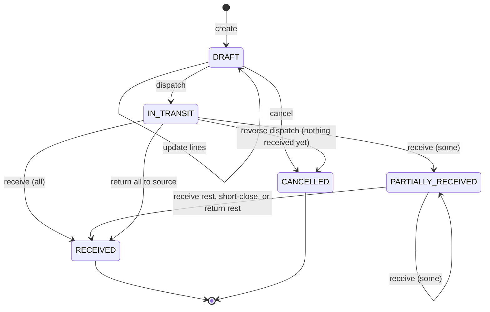
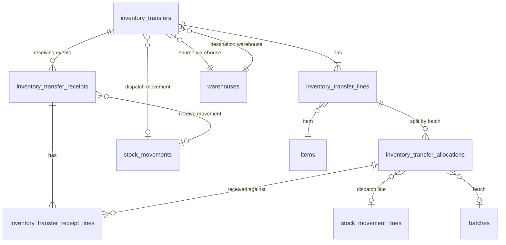
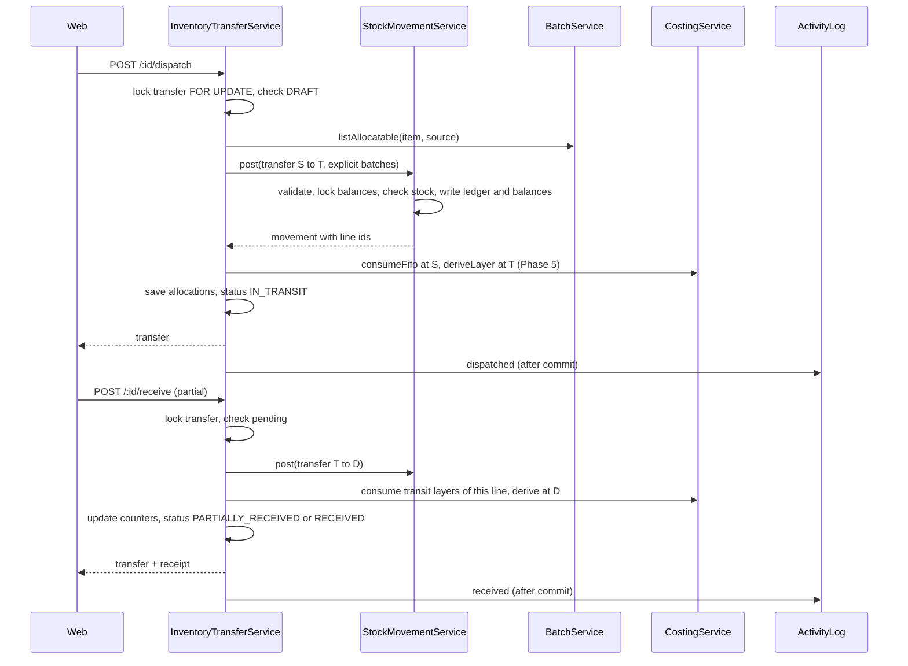

# Inventory Transfer: Implementation Specification

| | |
|---|---|
| Version | 1.0 · 2026-11-26 |
| Status | proposed |
| Owner | Khalid Alex (product owner), implementation by Avuny Bot / other agents |
| Depends on | stock-movement, warehouse and warehouse-location (IN-TRANSIT system location), batch, item and units, inventory-costing, accounting (transit loss only), role (permissions), activity-log |

Docs only. No application code was changed to write this. Base: `main` at `1a41a01` (v0.4.0, migrations up to `0026_receipt_line_expiry`). Companion files: [`PROGRESS.md`](./PROGRESS.md), [`TEST-PLAN.md`](./TEST-PLAN.md). Section 13 holds the repository evidence this spec rests on.

Legend: **[CURRENT]** exists in code today, **[PROPOSED]** recommended change, **[OPEN]** undecided (section 14). Paths under `apps/server/src/api/modules/` are written `modules/`.

## 0. Reading order for agents

`AGENTS.md` (root, `apps/server/AGENTS.md`, `packages/db/AGENTS.md`), then this file sections 1 to 3, then section 13 for the evidence, then the section for the current phase (section 12). Resume work from PROGRESS.md.

## 1. Goals and non-goals

Goals:

1. Move stock between physical locations and warehouses of one organization with a draft, dispatch, in-transit and receive flow, including partial receiving, return of the rest, short-close and reversal.
2. Preserve total quantity and total value across a transfer, except for an explicit loss.
3. Preserve batches, post every quantity change through the existing stock movement service, and keep one ledger as the audit trail.
4. Follow the repo's module conventions (six service methods, permissions from the registry, audit after commit).

Non-goals (v1):

- No accounting journal for ordinary transfers (section 9.4 explains why).
- No reservations, approval workflow, serial numbers, carrier or freight cost, or transfers between organizations.
- No change to purchasing (`in_transit_qty` and the inventory projection stay purchasing only).

## 2. Domain model and boundaries

### 2.1 Entities

`inventory_transfers` (document) has `inventory_transfer_lines` (what and where). Each line is split into `inventory_transfer_allocations` (per batch, created at dispatch). Receiving, returning and write-off events are `inventory_transfer_receipts` with `inventory_transfer_receipt_lines`. Each event owns exactly one stock movement. Tables are in section 5.

The module **owns** the document, its counters and the link to movements. It **must not** touch `inventory_items`, `inventory_item_batches` or cost layers directly; the stock movement service and the costing service own them. It must not touch `in_transit_qty`.

### 2.2 Reuse as is

| Need | Reuse | File |
| --- | --- | --- |
| Post and reverse stock | `stockMovementService.post` / `.reverse` with `type: "transfer"` | `modules/stock-movement/` |
| Locking, availability check, negative-stock guard, batch rules, location gate | inside `commit` | same |
| Unit to base conversion | `resolveUnitConversion` pattern (`ItemConversionPort`) | `inventory-adjustment.types.ts`, `deps.ts` |
| Location validation | `WarehouseLocationPort.validateLocation` | same |
| Batch availability and status | `batchService.listAllocatable`, `findForPosting` | `modules/batch/` |
| Batch split algorithm | `allocateBatches` | `packages/contracts/src/stock-movement/batch-allocation.ts` |
| Permissions, audit | `permissionChecker`, `activityLogService.log` | `modules/role/`, `modules/activity-log/` |
| Accounting for a transit loss | `accountingService.postBusinessEvent` (`inventory_adjustment`, `shortage`) | `modules/accounting/` |
| Stock availability views | `getItemStock`, `getOnHand`, `listBalances` | `modules/stock-movement/` |

### 2.3 New

- Contracts module `packages/contracts/src/inventory-transfer/` (constants, schemas, errors, locales, SPEC pointer).
- Registry entry `inventory_transfer` in `packages/contracts/src/modules/registry.ts`.
- DB schema `packages/db/src/schema/inventory/inventory-transfer.ts` and migration `0027_inventory_transfer.sql` (drizzle).
- Server module `modules/inventory-transfer/`.
- Costing service additions (9.3).
- Web feature `apps/web/src/features/inventory-transfer-module/` and routes.
- New `sourceType` strings `inventory_transfer_dispatch`, `inventory_transfer_receipt`, `inventory_transfer_return`, `inventory_transfer_loss` (must match `/^[a-z][a-z0-9_]*$/`, max 40 chars; all are).

### 2.4 Location and warehouse rules (existing and added)

- **[CURRENT]** Both sides must pass `assertPostable` with `move_out` and `move_in`: active warehouse, active and stockable location, destination not blocked.
- **[PROPOSED]** Extra transfer-service checks, done before posting with `validateLocation`: source and destination must be in **physical** warehouses (virtual warehouses are never selectable), `source != destination`. **[OPEN Q6]** also require destination `isReceivable` and source `isPickable`; the movement engine does not enforce them for `transfer` (13.9), so this needs an extra read, not an engine change.

## 3. Lifecycle and status model

**[PROPOSED]** Every transfer is two stock movements of type `transfer`:

1. **Dispatch**: source location to `IN-TRANSIT`.
2. **Receive**: `IN-TRANSIT` to destination location (one movement per receiving event, so partial receiving works).

Why not a single movement from source to destination:

- The ledger history query shows a physical to physical line wrongly (13.3).
- The unique source index allows one movement per `(source_type, source_id)`, so partial receiving needs separate movements anyway.
- Goods that leave a bin are physically unavailable at the source even if nobody has received them yet. Showing them in transit is truthful and `getItemStock` already reports it.
- It matches the sales-delivery spec's pattern for owned transit.

A "receive immediately" convenience (one request that dispatches and receives in full, two movements) is allowed. **[OPEN Q1]** whether to include it in v1.

Same-warehouse relocation (bin to bin) uses the same flow. **[OPEN Q2]** whether to offer it, or to leave it to the adjustment module.

**[PROPOSED]** Statuses (`INVENTORY_TRANSFER_STATUSES`):

| Status | Meaning | Stock effect |
| --- | --- | --- |
| `DRAFT` | Editable plan. | none |
| `IN_TRANSIT` | Dispatched, nothing received yet. | source down, transit up |
| `PARTIALLY_RECEIVED` | Some received, some still in transit. | partly moved on to destination |
| `RECEIVED` | Everything dispatched is received, lost or returned. | final |
| `CANCELLED` | Cancelled in `DRAFT`. | none |

The status is derived from per-allocation counters after every dispatch, receipt, short-close, return or reversal, never typed in by the client.

**No separate approval step in v1.** Neither adjustment (`confirm`) nor receipt (`post`) has one. The `dispatch:inventory-transfer` permission is the approval gate. **[OPEN Q3]** add `submit`/`approve` before dispatch if the business needs two people.

Transitions:



Reversing a dispatch is only allowed while nothing was received, lost or returned. The transfer then ends as `CANCELLED` and stock is back at the source.

## 4. Business rules

Tags: E existing behavior, P proposed, U unresolved (section 14). Tests reference these ids.

**R1. Valid source and destination.** Both real, active, stockable, same org, in physical warehouses, different locations. *(tag: E (engine) + P (physical, different))*

**R2. Receivable and pickable.** Engine does not require them for `transfer`. *(tag: E gap, U Q6)*

**R3. Insufficient stock.** Dispatch fails with `STOCK_MOVEMENT_INSUFFICIENT_STOCK` (nothing written). Transfer service also checks available (on hand minus reserved) first. *(tag: E + P)*

**R4. Negative inventory.** Items with `allowNegativeStock` may go negative at a real source; transit never goes negative. Proposed: transfers ignore `allowNegativeStock` and never dispatch more than is available. *(tag: E (engine allows) + P (stricter), U Q9)*

**R5. Batch preservation.** The same batch ids leave the source and arrive at the destination. A batch not allowed to move (blocked, recalled, expired) is rejected by `batchAllowsIntent` at dispatch. Receive and reversals use adjust-style checks only on reversals. *(tag: E)*

**R6. Batch allocation.** Auto-allocation is FEFO for expiry items, FIFO otherwise, done by the transfer service so it can store it. *(tag: P)*

**R7. Partial dispatch.** At dispatch the user may lower a line's quantity (never raise). A line lowered to 0 is dropped. The rest of the draft is not kept; to move more, create another transfer. *(tag: P, U Q10)*

**R8. Partial receiving.** Any number of receipts. Per allocation, `received <= pending` where `pending = dispatched - received - lost - returned`. *(tag: P)*

**R9. Over-receipt.** Rejected. *(tag: P, U Q4)*

**R10. Duplicates.** A draft may not repeat the same `(item, sourceLocation, destinationLocation)` line (same idea as `INVENTORY_ADJUSTMENT_DUPLICATE_LINES`). Posting twice is stopped by the transfer row lock plus status check, and by `ux_stock_movement_org_source`. Each receipt has its own id, so repeated receive calls cannot reuse one source. *(tag: E (index) + P)*

**R11. Idempotency.** No `Idempotency-Key` exists anywhere in the repo, so none is added. A repeated dispatch returns `ALREADY_DISPATCHED`. A repeated receive request with the same quantities after success is a legitimate second receipt and is rejected only by the `received <= pending` rule. The web form must disable the button while submitting. *(tag: P, U Q11)*

**R12. Concurrency.** Transfer row `forUpdate` first, then the engine locks all touched balance rows in key order (both sides together, so opposite transfers do not deadlock). *(tag: E)*

**R13. Cancellation.** Only `DRAFT` can be cancelled. *(tag: P (mirrors adjustment))*

**R14. Reversal after dispatch only.** `stockMovement.reverse(dispatch)` is allowed while nothing is received, lost or returned. *(tag: P)*

**R15. Reversal after partial receipt.** Reversing the dispatch would fail (transit no longer holds everything), so use "return rest to source" instead. *(tag: P)*

**R16. Reversal of a receipt.** Allowed per receipt if the destination still has the stock; the engine fails with insufficient stock otherwise. A reversal cannot be reversed. *(tag: E (engine))*

**R17. Quantity precision.** Base unit, numeric string, up to 6 decimals, positive (`STOCK_MOVEMENT_QUANTITY_REGEX`). Entered quantity and unit are stored with the base quantity, as adjustments do. *(tag: E + P)*

**R18. Costing precision.** Integer minor units, last take takes exact remainder (9.3). *(tag: P)*

**R19. Movement consistency.** Every transfer quantity change goes through exactly one posted movement; the transfer tables store only document counters and the movement/line ids. A reconciliation test asserts counters equal ledger sums (Section 8). *(tag: P)*

**R20. Same item on two transfers.** The transit location is shared, so per-transfer counters (not the transit balance) decide how much a transfer may receive. *(tag: P)*

**R21. Item deactivated mid-transit.** Forward checks reject inactive items (`ITEM_INACTIVE`), so receiving a deactivated item fails. Proposed: receive and return use `forwardChecks=false` semantics where possible. The engine only offers that for reversals, so **this needs a decision**. *(tag: U Q12)*

**R22. Location deactivated mid-transit.** `assertPostable` rejects the destination. The user must pick another destination at receive time (receipt lines carry their own destination). *(tag: P)*

**R23. Document number.** Do not use `count + 1`. *(tag: P, see section 5)*

## 5. Database design

Follow the conventions in `packages/db/AGENTS.md` and the adjustment schema (`pk()`, `orgRef()`, `timestamps()`, composite org FKs, constraint names `ux_/fk_/ck_/ix_`).



`inventory_transfers`: `id`, `org_id`, `number` (unique per org), `reference_number`, `date`, `source_warehouse_id`, `destination_warehouse_id`, `status` (pg enum `inventory_transfer_status`), `description`, `dispatched_at`, `dispatched_by`, `dispatch_movement_id`, `created_by`, timestamps. Checks: number format, text lengths.

`inventory_transfer_lines`: `id`, `org_id`, `transfer_id`, `line_no`, `item_id`, `source_location_id`, `destination_location_id`, `unit_id`, `requested_qty` (entered), `requested_base_qty`, `dispatched_base_qty`, `notes`. Unique `(transfer_id, line_no)` and `(transfer_id, item_id, source_location_id, destination_location_id)`. Check `requested_base_qty > 0`.

`inventory_transfer_allocations`: `id`, `org_id`, `line_id`, `batch_id` (nullable), `dispatched_base_qty`, `received_base_qty`, `lost_base_qty`, `returned_base_qty`, `dispatch_movement_line_id`. Checks: all `>= 0` and `received + lost + returned <= dispatched`.

`inventory_transfer_receipts`: `id`, `org_id`, `transfer_id`, `receipt_no`, `received_at`, `received_by`, `movement_id`, `status` (`POSTED`/`REVERSED`), `note`.

`inventory_transfer_receipt_lines`: `id`, `org_id`, `receipt_id`, `allocation_id`, `destination_location_id`, `received_base_qty`, `movement_line_id`.

Allocations only exist after dispatch; drafts have lines only. Return and loss events reuse the receipts table with a `kind` column (`RECEIPT`, `RETURN`, `LOSS`) so every event has one movement and one source id. **[PROPOSED]** (alternative: three tables; pick one in review.)

Document numbers: prefix `TRF-`, pad 6, taken from a per-org counter row locked `forUpdate` (not `count + 1`, 1.5). If a counter table is too heavy for v1, use `max(number)` parsed under the same org-level lock the accounting service uses (`repo.lockOrg`-style) and keep the unique index as the safety net.

## 6. Contracts and API

### 6.1 Contracts (`packages/contracts/src/inventory-transfer/`)

`constants.ts` (statuses, receipt kinds, number prefix/pad, limits, audit events matching the registry), `schemas.ts` (zod; export `CreateInventoryTransferInput`, `UpdateInventoryTransferInput`, `DispatchInventoryTransferInput`, `ReceiveInventoryTransferInput`, `ReturnInventoryTransferInput`, `CloseShortInventoryTransferInput`, `ReverseInventoryTransferReceiptInput`, DTOs, list query and response), `errors.ts` (`InventoryTransferErrorCode`), `locales/{en,ar}.json`, `index.ts`, and a `schemas.test.ts` (no direct JSON import in contracts tests; CI is stricter than local). Also update `packages/contracts/src/stock-movement/SPEC.md` (the `transfer` row says "Future") and root `AGENTS.md` note about From/To columns.

Error codes (names only, each with HTTP status and en/ar text): `INVENTORY_TRANSFER_NOT_FOUND`, `_NO_LINES`, `_DUPLICATE_LINES`, `_SAME_LOCATION`, `_WAREHOUSE_NOT_PHYSICAL`, `_LOCATION_NOT_FOUND`, `_LOCATION_NOT_IN_WAREHOUSE`, `_LOCATION_NOT_STOCKABLE`, `_LOCATION_BLOCKED`, `_ITEM_NOT_FOUND`, `_ITEM_INACTIVE`, `_ITEM_NOT_STOCKED`, `_UNIT_NOT_IN_COLLECTION`, `_BATCH_NOT_TRACKED`, `_BATCH_NOT_FOUND`, `_INSUFFICIENT_STOCK`, `_NOT_DRAFT`, `_NOT_DISPATCHABLE`, `_ALREADY_DISPATCHED`, `_NOT_RECEIVABLE`, `_EXCEEDS_PENDING`, `_NOTHING_PENDING`, `_CANNOT_REVERSE`, `_HAS_RECEIPTS`, `_POSTING_FAILED`, `_NUMBER_TAKEN`.

### 6.2 Server module (`modules/inventory-transfer/`)

Files (same layout as `inventory-adjustment`): `deps.ts`, `index.ts`, `inventory-transfer.service.ts`, `.repository.ts`, `.mapper.ts`, `.types.ts` (ports), `.errors.ts`, `.error-map.ts`, `.permissions.ts`, `hono-routes/*.route.ts` + `index.ts`, `.service.spec.ts`, `testing.ts`. Register in `routes.ts` (`app.route("/inventoryTransfer", inventoryTransferRoutes)`), `i18n/i18next.ts` (en and ar, add to `ns`), `sidebar.permission-map.ts` (`inventoryTransfer: "inventory-transfer"`), `test-support/database.ts`.

Ports in `.types.ts`: `ItemConversionPort`, `WarehouseLocationPort`, `BatchPort` (`listAllocatable`), `StockMovementPort` (`post`, `reverse`, `getBySource`), `InventoryCostingPort` (new methods, Phase 5), `AccountingPort` (Phase 6), plus `StockLevelPort` for the available check.

Service methods:

| Method | Permission | Behavior |
| --- | --- | --- |
| `create` | `create` | Validate warehouses (physical, different or allowed by Q2), each line (`validateLocation` for both sides, `resolveUnitConversion`, duplicate lines), number, insert `DRAFT`. |
| `update` | `update` | Draft only, replace lines like adjustment `update`. |
| `delete` | `delete` | Draft only, hard delete. |
| `get`, `list`, `listOptions` | `read` | Standard. `get` includes allocations, receipts and `pendingBaseQty` per allocation. |
| `dispatch` | `dispatch` | Below. |
| `receive` | `receive` | Below. |
| `returnToSource` | `return` | Move remaining in-transit quantity back (movement `T` to `S`). |
| `closeShort` | `close_short` | Write off remaining in-transit as lost (movement `adjustment`, optional journal). |
| `cancel` | `cancel` | Draft to `CANCELLED`. |
| `reverseDispatch` | `reverse` | Only when no receipt, loss or return exists. Uses `stockMovement.reverse`. |
| `reverseReceipt` | `reverse` | `stockMovement.reverse` of that receipt's movement, restores allocation counters. |

**`dispatch` algorithm** (one `repo.transaction`, `PostingAbort`-style throw for any failure after the first write):

1. Permission. Load transfer `forUpdate`. Status must be `DRAFT`, else `ALREADY_DISPATCHED` or `NOT_DISPATCHABLE`.
2. Apply optional lowered quantities from the request, drop zero lines, require at least one line.
3. Re-validate locations and items (they may have changed since the draft).
4. Check available stock per (item, source location, batch).
5. Pre-allocate batches (9.2).
6. `stockMovement.post(actorId, orgId, { type: "transfer", sourceType: "inventory_transfer_dispatch", sourceId: transfer.id, sourceRef: transfer.number, lines: [{ itemId, batchId, fromLocationId: S, toLocationId: T, quantity }] }, tx)`. Note: for the `transfer` type **both** sides are supplied by the caller (`resolveSides`), so `T` is the org's `transit` system location id. Read it with `stockMovement` repository `findSystemLocationIds` through a small port, never hard-code it.
7. Insert allocations with the posted line ids (explicit batches mean `lineNo` order is preserved, unlike batch-less lines).
8. Costing (Phase 5).
9. Update status `IN_TRANSIT`, `dispatched_*`, `dispatch_movement_id`.
10. After commit: audit `inventory_transfer.dispatched`.

**`receive` algorithm:**

1. Permission. Load transfer `forUpdate`. Status `IN_TRANSIT` or `PARTIALLY_RECEIVED`.
2. For each request line (allocation id, `receivedQty` in base or entered unit converted, `destinationLocationId` defaulting to the line's): `received <= pending`, destination passes `validateLocation` (physical warehouse; the destination warehouse of the transfer, **[OPEN Q13]** allow a different one).
3. Insert the receipt row first so its id is the movement `sourceId`.
4. `stockMovement.post({ type: "transfer", sourceType: "inventory_transfer_receipt", sourceId: receipt.id, sourceRef: `${transfer.number}/${receiptNo}`, lines: [{ itemId, batchId, fromLocationId: T, toLocationId: D, quantity }] }, tx)`.
5. Insert receipt lines with movement line ids, increase `received_base_qty` on each allocation, costing (Phase 5).
6. Recompute status: `RECEIVED` if every allocation has `pending == 0`, else `PARTIALLY_RECEIVED`.
7. Audit `inventory_transfer.received` after commit.

Both steps rely on the engine for the transit check: transit stock never goes negative, so a receipt larger than the transit balance fails even if the counters were wrong.

### 6.3 API

Base path `/inventory-transfers` (mounted as `/inventoryTransfer`, matching the repo's route mount convention; confirm against `routes.ts` when implementing). All bodies are JSON, quantities are strings, dates `YYYY-MM-DD`.

| Method and path | Purpose |
| --- | --- |
| `POST /inventory-transfers` | Create draft |
| `GET /inventory-transfers` | List (page, pageSize, search, status, source/destination warehouse, date range) |
| `GET /inventory-transfers/options` | Picker options |
| `GET /inventory-transfers/:id` | Detail |
| `PATCH /inventory-transfers/:id` | Update draft |
| `DELETE /inventory-transfers/:id` | Delete draft |
| `POST /inventory-transfers/:id/dispatch` | Dispatch |
| `POST /inventory-transfers/:id/receive` | Receive (full or partial) |
| `POST /inventory-transfers/:id/return` | Return the rest to source |
| `POST /inventory-transfers/:id/close-short` | Write off the rest as lost |
| `POST /inventory-transfers/:id/cancel` | Cancel draft |
| `POST /inventory-transfers/:id/reverse` | Reverse the dispatch (nothing received) |
| `POST /inventory-transfers/:id/receipts/:receiptId/reverse` | Reverse one receipt |
| `GET /inventory-transfers/available-stock?itemId=&locationId=` | Available per batch for the form (can reuse `getItemBatchStock`/`listBalances` instead) |

Create request:

```json
{
  "date": "2026-11-27",
  "referenceNumber": "WO-4471",
  "sourceWarehouseId": "0f6c...",
  "destinationWarehouseId": "9ab2...",
  "description": "Restock branch",
  "lines": [
    {
      "itemId": "c1d0...",
      "sourceLocationId": "11aa...",
      "destinationLocationId": "22bb...",
      "unitId": "u-box",
      "quantity": "10",
      "notes": null
    }
  ]
}
```

Create response (abridged):

```json
{
  "success": true,
  "data": {
    "id": "t-01", "number": "TRF-000001", "status": "DRAFT",
    "lines": [{ "id": "l-01", "lineNo": 1, "itemId": "c1d0...", "unitId": "u-box",
                "requestedQty": "10", "requestedBaseQty": "120", "baseUnitId": "u-pcs",
                "allocations": [] }]
  },
  "msg": "Inventory transfer created successfully"
}
```

Dispatch request (all fields optional; omit the body to dispatch every line in full):

```json
{ "lines": [{ "lineId": "l-01", "baseQuantity": "100", "batches": [{ "batchId": "b-77", "baseQuantity": "100" }] }] }
```

Dispatch response adds `status: "IN_TRANSIT"`, `dispatchMovementId`, and per line `allocations: [{ "id": "a-1", "batchId": "b-77", "dispatchedBaseQty": "100", "receivedBaseQty": "0", "pendingBaseQty": "100" }]`, plus `uncoveredCostQty` after Phase 5.

Receive request:

```json
{
  "receivedAt": "2026-11-28T09:30:00Z",
  "note": "Truck 3",
  "lines": [{ "allocationId": "a-1", "baseQuantity": "90", "destinationLocationId": "22bb..." }]
}
```

Receive response: the updated transfer with `status: "PARTIALLY_RECEIVED"`, the new receipt (`id`, `receiptNo`, `movementId`) and `pendingBaseQty: "10"` on `a-1`.

Error response shape follows the existing error map (`{ success: false, error: "INVENTORY_TRANSFER_EXCEEDS_PENDING", msg: "..." }`), for example 409 for state errors, 422 for validation, 403 for permission.

Sequence:



## 7. UI

### 7.1 Web UI

Follow `apps/web/src/features/inventory-adjustment-module/` (list, details, forms, components, lib, api file, tests) and `docs/FRONTEND.md`, `docs/FORMS.md`, `docs/COPY.md`. Routes under `apps/web/src/routes/organization/$orgId/inventory-transfers/` (`index.tsx`, `$transferId.tsx`). Strings go through i18n in en and ar (Arabic needs a native check).

- **List:** number, date, source to destination, status badge, line count, quick actions by status. Filters: status, warehouse, date.
- **Create/edit form:** source and destination warehouse selectors (physical only), then lines. Each line: item picker, source location, destination location (defaults to the destination warehouse default location), unit, quantity. Under each item the form shows available stock at the chosen source location (per batch for batch-tracked items) from `getItemBatchStock`/`listBalances`, and blocks quantities above available. Batch selection is optional (empty means auto FEFO/FIFO); showing the batch preview after dispatch is enough for v1.
- **Details:** header, timeline of events (dispatch, each receipt, return, loss) from the receipts and movement ids with links to the stock movement list, lines with dispatched/received/pending columns.
- **Status-dependent actions:** `DRAFT`: edit, delete, dispatch, cancel. `IN_TRANSIT` and `PARTIALLY_RECEIVED`: receive, return rest, close short, and (dispatch reverse when nothing received). `RECEIVED` and `CANCELLED`: read only. Hide actions the user lacks permission for.
- **Receive dialog:** one row per allocation prefilled with `pending`; the user edits received quantity; if less than pending the dialog states what will remain in transit and offers "return rest" or "close as lost" as separate follow-up actions (never automatic).
- **Validation:** same rules as the API, shown inline; server errors map to translated messages.
- **History:** receipts list on the details page and the stock movement list filtered by `sourceType`.

---

### 7.2 Stock movement list (existing code that must change with this module)

- **[CURRENT]** The history query already shows each transfer line correctly because every line has one physical side (13.3). From/To columns in `apps/web/src/features/stock-movement-module/` may now be rendered for type `transfer`, per the repo's own restriction text. Add a `transfer` type label and, for `inventory_transfer_*` sources, a link to the transfer document.
- **Warning:** if Q2 or Q1 ever introduced direct physical to physical movements, `direction` and `running_balance` in the history CTE would be wrong and must be reworked first.

## 8. Permissions

Registry entry (**[PROPOSED]**):

```ts
inventory_transfer: {
  sidebar: { group: "inventory", icon: "arrow-left-right"?, path: "/inventory-transfers",
             label: { en: "Inventory transfers", ar: "تحويلات المخزون" } },
  actions: {
    ...CRUD,
    dispatch: { permission: true, event: "dispatched" },
    receive:  { permission: true, event: "received" },
    return:   { permission: true, event: "returned" },
    cancel:   { permission: true, event: "cancelled" },
    reverse:  { permission: true, event: "reversed" },
    close_short: { permission: true, event: "closed_short" },
  },
}
```

`stock_movement` already uses `arrow-left-right`; pick a different lucide icon (for example `truck`) so the sidebar entries differ. The new module then needs `pnpm seed` (sidebar) on every environment. Audit rows are written after commit via `activityLog` (AGENTS §5.4). Permission keys: `create|read|update|delete|dispatch|receive|return|cancel|reverse|close_short:inventory-transfer`.

---

Default grants for built-in roles: **[OPEN]** follow how `inventory_adjustment` is granted in `modules/role` seeds when implementing; this spec does not assume them.

## 9. Accounting and inventory effects

### 9.1 What changes at each stage

Notation: `S` source location, `T` IN-TRANSIT location, `D` destination location, `q` quantity in base unit, `b` batch. Balances are `inventory_items` / `inventory_item_batches` rows.

| Stage | Stock movement | Quantities | Batches | Valuation | Accounting |
| --- | --- | --- | --- | --- | --- |
| Create or edit draft | none | none | optional batch preference only | none | none |
| Dispatch | one `transfer` movement `S` to `T`, `sourceType "inventory_transfer_dispatch"`, `sourceId transfer.id` | `S.onHand -= q`, `T.onHand += q` per batch | the service pre-allocates batches (9.2) and posts explicit `batchId` per line; same batch ids arrive in transit | FIFO layers at `S` consumed, derived layers created at `T` with `origin_cost_layer_id` (9.3) | none |
| Receive (full or partial) | one `transfer` movement `T` to `D` per receiving event, `sourceType "inventory_transfer_receipt"`, `sourceId receipt.id` | `T.onHand -= r`, `D.onHand += r` | same batch as dispatched | derived layers at `T` consumed, derived layers at `D` created | none |
| Short-close (loss in transit) | one `adjustment` movement `T` to ADJUSTMENT location, `sourceType "inventory_transfer_loss"`, `sourceId loss.id` | `T.onHand -= lost` | same batch | layers at `T` consumed, value is the loss | optional shortage journal (9.4) |
| Return rest to source | one `transfer` movement `T` to `S`, `sourceType "inventory_transfer_return"` | `T.onHand -= x`, `S.onHand += x` | same batch | derived layers back at `S` | none |
| Reverse a receipt | `stockMovement.reverse(receipt movement)` | `D.onHand -= r`, `T.onHand += r` | same | derived layers at `D` consumed, restored at `T` | none |
| Reverse a dispatch (nothing received) | `stockMovement.reverse(dispatch movement)` | `T.onHand -= q`, `S.onHand += q` | same | restored at `S` | none |

**Conservation rule.** For every line and batch: `dispatched = received + lost + returned + stillInTransit`. Total quantity across `S`, `T`, `D` and the loss location is unchanged by dispatch, receive and return, and changes only by the explicit `lost` quantity. Value follows the same equation, and the last take from a layer takes the exact remaining value (9.3), so rounding never creates or destroys value.

Differences at receiving: the user enters the received quantity per allocation. `received > pending` is rejected (section 4). `received < pending` leaves the rest in transit until received later, short-closed, or returned. Over-receipt is not allowed in v1 (**[OPEN Q4]**).

---

### 9.2 Batch allocation must live in the transfer service

`commit` splits batch-less outbound lines, but the caller cannot see which line became which batch (the expansion happens inside `commit`; posted lines come back already split). The transfer must record how much of **each batch** was dispatched, because partial receiving works per batch. So:

**[PROPOSED]** At dispatch the transfer service:

1. For each draft line, if the user named batches, use them; otherwise read `batches.listAllocatable(orgId, itemId, sourceLocationId, tx)` and run `allocateBatches(qty, pool, isExpiryTracked ? "fefo" : "fifo")`, subtracting what earlier lines of the same transfer already claimed (same logic as `commit` step 1b).
2. Post the movement with an explicit `batchId` on every line, so `commit` never expands them and line order is preserved.
3. Persist one `inventory_transfer_allocations` row per (line, batch) with the posted `stock_movement_line.id`.

Only items whose policy says `isBatchTracked = false` get a null batch.

### 9.3 Costing (valuation)

**Today** layers exist only for receipts and opening stock, nothing consumes them on issue, and adjustments ignore them. So a transfer that ignores costing would leave the source layers behind while the stock moves. Nothing reads layers yet (no sales delivery), so this is not visible today, but it would corrupt the first FIFO consumer.

**[PROPOSED]** Costing moves with the stock using the schema that is already there. New `inventoryCostingService` methods (additive, existing methods unchanged):

- `consumeFifo(orgId, { inventoryItemId, inventoryItemBatchId, qty, outgoingMovementLineId }, tx)`: loads `getFifoLayers(..., { forUpdate: true })`, takes `min(remaining, need)` from each layer in `received_at, id` order, calls `recordAllocation`, returns `[{ layer, qty, value }]` plus the uncovered quantity.
- `deriveLayer(orgId, { fromLayer, toInventoryItemId, toInventoryItemBatchId, qty, value, sourceMovementLineId }, tx)`: `createCostLayer` with `originCostLayerId = fromLayer.id` and `receivedAt = fromLayer.receivedAt` (keeps the age for FIFO).
- `consumeLayersOfSourceLine(orgId, sourceMovementLineId, qty, outgoingMovementLineId, tx)`: for receive, return and loss, consume **only the transit layers created by this allocation's dispatch line** (`getLayersBySourceLine`), in FIFO order. This matters because the transit location is shared by all transfers; a plain FIFO pick at `T` could take another transfer's layers.

Value math (integers, minor units): taking `take` of a layer with `remainingQty = R`, `remainingValue = V`: `value = take == R ? V : floor(V * take / R)` using bigint. Taking the whole remainder takes the exact remaining value, so the sum of takes always equals the layer total and value is preserved exactly.

Order inside dispatch: post movement, then for each allocation `consumeFifo` at `S`, then `deriveLayer` at `T`. The layer rows need the balance rows to exist; `commit` creates them (`lockBalances`), as purchase receipt relies on (`costLayerAdapter` throws "Inventory item row missing after stock movement" otherwise).

Reversals: reverse the movement, then consume the derived layers at the destination side and derive new layers back at the origin side (the schema comment says this is the intended way for outbound reversals).

**Uncovered stock [OPEN Q5].** Stock that has no layer (for example gains from adjustments) cannot be costed. Options: move it at zero value and create no layer (matches today's adjustment behavior), or block the transfer. Spec default: move without layers and report `uncoveredQty` in the response so nothing is hidden.

**Phasing [PROPOSED].** Costing is its own phase (Phase 5). Stock transfer is usable before it. If Phase 5 is skipped, document the divergence in `docs/audits/PROGRESS.md`.

### 9.4 Accounting

- No journal for dispatch, receive, return or reversals (13.7).
- **[PROPOSED, optional, Phase 6]** When a transit loss is written off, post `{ event: "inventory_adjustment", kind: "shortage", amountMinor: <layer value consumed>, sourceId: loss.id }`. Unlike adjustments, this passes a real amount. The consumed value comes from 3.4, so this phase depends on Phase 5. **[OPEN Q7]** whether a transit loss is expensed immediately or held as a claim against a carrier.
- Do not copy the adjustment pattern that ignores a failed journal. A failed shortage journal must throw and roll back the whole short-close.

### 9.5 Reservations and fulfillment

No service exists (13.8). **[PROPOSED]** v1 creates no reservations. At dispatch the transfer service checks `available = onHand - reserved` per location and batch before posting (reserved is 0 today, so this is correct now and stays correct when reservations ship), because the engine itself only checks on hand. **[OPEN Q8]** whether a draft should reserve stock.

## 10. Reporting and reconciliation

- Per transfer: for every allocation, `dispatched = received + lost + returned + pending`; counters equal the sum of the transfer's movement lines (by `source_type` and `source_id`).
- Per organization: `inventory_items` and `inventory_item_batches` totals equal ledger sums; quantity sitting in IN-TRANSIT equals the sum of `pending` over open transfers.
- With costing (Phase 5): layers' `remaining_qty` equals the stock they cover, and total `remaining_value` is unchanged by any transfer step except an explicit loss.
- Reports: the stock movement list shows both legs (section 7.2); the item stock view already reports in-transit (`getItemStock`). A dedicated "transfers in transit" list is the transfer list filtered by status.

## 11. Acceptance criteria

- **AC1** A draft can be created, edited, deleted and cancelled; none of these change stock (R1 to R8).
- **AC2** Dispatch moves the quantity from source to IN-TRANSIT in one movement with explicit batch ids; `getItemStock` shows it as in transit.
- **AC3** Dispatch with insufficient available stock fails and writes nothing.
- **AC4** Receiving in full moves stock to the destination and sets `RECEIVED`; partial receiving sets `PARTIALLY_RECEIVED` and leaves the rest in transit.
- **AC5** Receiving more than pending is rejected.
- **AC6** Return of the rest and short-close each post one movement and keep total quantity equal to the original (loss excepted).
- **AC7** Batches at the destination equal batches dispatched.
- **AC8** Repeated dispatch or repeated reversal is rejected; no duplicate movement exists.
- **AC9** Opposite transfers running concurrently do not deadlock; concurrent receipts cannot exceed pending.
- **AC10** An injected failure after the movement rolls back movement, allocations, layers and status.
- **AC11** Each endpoint enforces its permission; denied calls touch no repository and write no audit row.
- **AC12** (Phase 5) Total layer value is conserved through dispatch, partial receives, return and reversal.
- **AC13** (Phase 6) Short-close posts a balanced shortage journal; no other step posts a journal.
- **AC14** Locales en and ar have parity; no raw keys appear in the UI.

Each criterion maps to tests in [`TEST-PLAN.md`](./TEST-PLAN.md).

## 12. Implementation tasks

Order matters; each phase is its own PR (standing rule: PRs only, merging to `main` deploys to production). Task ids and gates live in PROGRESS.md.

### Phase 0: close open decisions

Task ids: `P0-01` and following (tracked in PROGRESS.md).

Get answers to section 14 (at least Q1 to Q6, Q9). No code.

### Phase 1: contracts, registry, schema

Task ids: `P1-01` and following (tracked in PROGRESS.md).

- **Objective:** types, permissions, tables.
- **Files:** `packages/contracts/src/inventory-transfer/*`, `packages/contracts/src/index.ts`, `packages/contracts/src/modules/registry.ts`, `packages/contracts/src/stock-movement/SPEC.md`, root `AGENTS.md` note, `packages/db/src/schema/inventory/inventory-transfer.ts` (+ `index.ts`, `relations.ts`), `packages/db/drizzle/0027_inventory_transfer.sql` (generate, do not hand-edit), `apps/server/src/api/intl/i18next.ts`, locale files.
- **Tasks:** enums, tables, constraints, zod schemas, errors, locales.
- **Dependencies:** none.
- **Acceptance:** `pnpm run typecheck` per package, contracts tests, migration applies on a clean DB, `seed:sidebar` creates the sidebar option.

### Phase 2: backend drafts

Task ids: `P2-01` and following (tracked in PROGRESS.md).

- **Objective:** create, update, delete, get, list, listOptions, cancel.
- **Files:** `modules/inventory-transfer/*`, `routes.ts`, `sidebar.permission-map.ts`, `test-support/database.ts`.
- **Tasks:** repository, service, mapper, ports, routes, permissions, audit, number generation.
- **Acceptance:** service spec covers permission denial (no repo or audit call), validation errors, duplicate lines, number collisions after delete.

### Phase 3: dispatch, return, reverse dispatch

Task ids: `P3-01` and following (tracked in PROGRESS.md).

- **Objective:** stock actually moves into transit.
- **Tasks:** batch pre-allocation, available check, `stockMovement.post`, allocations, status, `returnToSource`, `reverseDispatch`.
- **Dependencies:** Phase 2.
- **Acceptance:** after dispatch, `getItemStock` shows the quantity moved from `onHand` to `inTransit`; movement lines have explicit batch ids; ledger totals equal counters.

### Phase 4: receive, partial receive, close short, reverse receipt

Task ids: `P4-01` and following (tracked in PROGRESS.md).

- **Objective:** complete the lifecycle.
- **Tasks:** receipts tables, receive, counters, status derivation, `closeShort` (movement only, no journal), `reverseReceipt`.
- **Acceptance:** partial receive twice then full; reversal restores counters; opposite concurrent transfers do not deadlock.

### Phase 5: costing

Task ids: `P5-01` and following (tracked in PROGRESS.md).

- **Objective:** value moves with stock.
- **Files:** `modules/inventory-costing/inventory-costing.service.ts`, `.repository.ts`, `.types.ts`, `.service.spec.ts`; transfer deps adapter.
- **Tasks:** `consumeFifo`, `deriveLayer`, `consumeLayersOfSourceLine`, rounding rule, uncovered quantity, reversal restoration.
- **Acceptance:** for any sequence of dispatch, partial receives, return and reversal, total `remaining_value` across the org is unchanged except for explicit loss; per-layer `remaining_qty` and `remaining_value` never go negative; derived layers carry `origin_cost_layer_id`.

### Phase 6: accounting for transit loss (optional)

Task ids: `P6-01` and following (tracked in PROGRESS.md).

- **Tasks:** `closeShort` posts the `shortage` journal with the consumed value, throws on failure.
- **Acceptance:** journal balanced, reversal path defined, no journal on any other transfer step.

### Phase 7: web UI

Task ids: `P7-01` and following (tracked in PROGRESS.md).

- **Objective:** screens in 5.6.
- **Files:** `apps/web/src/features/inventory-transfer-module/*`, `apps/web/src/routes/organization/$orgId/inventory-transfers/*`, stock movement module label and From/To columns, generated API client, i18n.
- **Acceptance:** component and API tests as in `inventory-adjustment-api.test.ts`; manual run through the user journey; Arabic copy reviewed.

### Phase 8: docs and hardening

Task ids: `P8-01` and following (tracked in PROGRESS.md).

Update `docs/FEATURE-TRACKING.md`, `docs/features/REGISTRY.md`, `docs/TESTING-PLAN.md`, `docs/audits/PROGRESS.md`; add a reconciliation script or test (counters vs ledger vs layers).

---

## 13. Repository checks before implementation

The evidence below was read from `main` `1a41a01`. Section 13.11 lists what was verified and what was not.

### 13.1 Rules the repo already sets for stock-affecting modules

- **[CURRENT]** Root `AGENTS.md` ("Stock Movement Conventions") and `packages/contracts/src/stock-movement/SPEC.md` §"future modules": a module that affects stock posts through the stock movement service, uses a movement type from `STOCK_MOVEMENT_TYPES`, states its direction, and updates the stock movement SPEC. Quantities are positive numeric strings in the item's base unit and are never converted to `number`. Virtual warehouses are not exposed in the UI.
- **[CURRENT]** Both files say From/To columns in the stock movement UI are reserved for Inventory Transfer ("Do not introduce From/To columns until transfer support is formally implemented"). This module is that formal implementation, so the stock movement list may start showing them (see 7.2).
- **[CURRENT]** `apps/server/AGENTS.md`: module layout, six mandatory service methods (`create`, `update`, `delete`, `get`, `list`, `listOptions`), domain methods added below them, §5.2 (returning `{ ok: false }` from inside a transaction does **not** roll it back; validate before writing or throw), §5.3 permissions, §5.4 audit after commit, §13 contracts registry.
- **[CURRENT]** `packages/contracts/src/modules/registry.ts` is the single source for permissions, activity-log events and sidebar entries. Adding a module there needs no migration but needs the sidebar seed (`pnpm seed` / `seed:sidebar`) to reach a database. Removing or renaming an action deletes grants from every role at the next seed.
### 13.2 Stock model

| Concept | Where | Notes |
| --- | --- | --- |
| Ledger header | `packages/db/src/schema/inventory/stock-movement.ts` `stock_movements` | `type`, `posted_at`, `source_type`, `source_id`, `source_ref`, `reversal_of_id`. Unique `ux_stock_movement_org_source (org_id, source_type, source_id)` where `source_id is not null and reversal_of_id is null`. Unique `ux_stock_movement_org_reversal`. |
| Ledger line | same file, `stock_movement_lines` | `from_location_id`, `to_location_id` (both always set, check `from <> to`), `batch_id`, `quantity > 0`. |
| Movement types | `packages/contracts/src/stock-movement/constants.ts` | `opening, purchase, purchase_return, sale, sale_return, transfer, adjustment, assembly_consume, assembly_produce`. `transfer` is already in the TS list and the DB enum (`stockMovementTypeEnum`). **No enum migration is needed.** |
| Side rules | `packages/contracts/src/stock-movement/rules.ts` `resolveSides`, table `SIDES` | `transfer: { from: {intent:"move_out"}, to: {intent:"move_in"} }`. Both locations are supplied by the caller. Other types fill the counterparty from system locations. `from == to` fails with `STOCK_MOVEMENT_SAME_LOCATION`. |
| Balance projection | `packages/db/.../inventory-item.ts` | `inventory_items` (one row per org, item, location: `on_hand_qty`, `reserved_qty`, `on_order_qty`, `in_transit_qty`) and `inventory_item_batches` (per row and batch: `on_hand_qty`, `reserved_qty`, `on_order_qty`). Available = on hand minus reserved (derived, not stored). |
| Posting service | `modules/stock-movement/stock-movement.service.ts` `createStockMovementService` | `post(actorId, orgId, input, tx?)`, `reverse(actorId, orgId, movementId, input, tx?)`, plus reads `get`, `getBySource`, `listLines`, `listBalances`, `getOnHand`, `getItemStock`, `getItemBatchStock`, `locationUsage`, `warehouseUsage`, `itemUsage`. |
| Repository | `modules/stock-movement/stock-movement.repository.ts` | `lockBalances` (creates missing balance rows, locks parents then batch rows in key order), `insertMovement`, `insertLines`, `applyBalanceDeltas`, `findSystemLocationIds`, history query (`listLineHistory`-style CTE near line 425). |
| Batch rules | `packages/contracts/src/stock-movement/batch-allocation.ts` `allocateBatches(quantity, batches, "fefo" \| "fifo")` | FEFO for expiry-tracked items, FIFO otherwise. |

**How `commit` works** (`stock-movement.service.ts`, the inner `commit` function, steps 1 to 6). This is the engine a transfer reuses unchanged:

1. Items exist, are active and track stock (reversals skip the active and stock checks via `forwardChecks=false`).
2. Outbound lines of a batch-tracked item with no `batchId` are split across batches by `allocateBatches`. The expanded lines are what gets written, so the caller can no longer map posted lines to its own lines by index. A shortfall fails with `STOCK_MOVEMENT_INSUFFICIENT_STOCK`.
3. Batch rules: batch required exactly when the item is batch-tracked, batch belongs to the item, `batchAllowsIntent(status, intent)`, expiry date present for expiry-tracked items.
4. Each real location passes `locations.assertPostable(orgId, locationId, intent, tx)` (`modules/warehouse-location/warehouse-location.service.ts`, ~line 860): warehouse and location active, location stockable, `receive` needs receivable, `issue` needs pickable, and unless the intent is `move_out` or `adjust` the location must not be blocked (also through ancestors).
5. Every balance row touched is locked in key order, both sides together (the code comment says this is what stops X to Y and Y to X transfers from deadlocking). Then "enough stock where stock leaves" is checked against **on hand** only. Stock in the transit location can never go negative (`line.fromLocationId !== system.transit`).
6. Header insert first (a taken source or a second reversal stops here), then lines, then `applyBalanceDeltas`.

`reverse` posts a new movement with from/to swapped on every line, same type, same source reference, `reversal_of_id` set, intents `adjust` (so blocked locations and recalled batches still work). A movement can be reversed once; a reversal cannot be reversed. Reversing needs the stock to still exist where it went.
### 13.3 System locations and "in transit"

- **[CURRENT]** `modules/warehouse/warehouse.defaults.ts` `SYSTEM_WAREHOUSES`: a virtual `TRANSIT` warehouse with one location `IN-TRANSIT` (`systemRole: "transit"`, stockable, **not** pickable, **not** receivable) and a virtual `VIRTUAL` warehouse with non-stockable counterparty bins (`SUPPLIER`, `CUSTOMER`, `ADJUSTMENT`, `PRODUCTION`). There is **one transit location per organization**, not one per warehouse pair.
- **[CURRENT]** `getItemStock` counts stock sitting in system warehouses as `inTransit`, added to the supplier-shipment counter `inventory_items.in_transit_qty`. A transfer in transit will therefore show up in "in transit" automatically.
- **[CURRENT]** The `in_transit_qty` column and `modules/inventory-projection/index.ts` (`applyInboundDeltas`) belong to purchasing (supplier shipments). Transfers must **not** touch them.
- **[CURRENT]** The stock movement history query (`stock-movement.repository.ts`, ledger CTE ~line 425) assumes exactly one physical side per line: `direction = case when to_wh.type = 'physical' then 'IN' else 'OUT'`, and the running balance partitions by the physical side. A line from a physical location straight to another physical location would be shown as `IN` at the destination only. **This is the strongest code-level reason to route every transfer through the transit location** (two movements, each with one physical side).
### 13.4 Purchase Order and Receiving (traced)

Purchase orders: `modules/purchase-order/` (spec `docs/modules/purchase-order/SPEC.md`). Shipments: `modules/purchase-shipment/purchase-shipment.service.ts` (`post` moves "on order" to "in transit" counters only; **no stock movement, no journal**; `void` takes it back). Receipt: `modules/purchase-receipt/purchase-receipt.service.ts`, `deps.ts`.

`purchaseReceiptService.post` (~lines 280 to 410), inside one `repo.transaction`, using a `PostingAbort` exception so any failure rolls back:

1. Re-check quantities against the live PO line counters (`checkQuantities`, `inTransitBaseQty`, `unshippedBaseQty`).
2. Batches: `deps.batches.resolve(...)` (`receiptBatchAdapter` in `deps.ts`, uses `batchService.ensureBatches`) creates a batch per receipt line for batch-tracked items and stores it with `setLineBatch`.
3. `deps.stockMovement.post(actorId, orgId, { type: "purchase", sourceType: PURCHASE_RECEIPT_SOURCE_TYPE, sourceId: receipt.id, sourceRef: receipt.number, lines: [{ itemId, batchId, toLocationId, quantity: acceptedBaseQty }] }, tx)`. Failure throws `PostingAbort`.
4. Posted lines are matched to receipt lines **by index** (`[...moved.data.lines].sort(lineNo)[i]`). That only works because inbound lines are never split.
5. `deps.costing.createLayer(orgId, { itemId, locationId, batchId, movementLineId, qty, valueMinor, currency, receivedAt }, tx)` (`costLayerAdapter` in `deps.ts`, which finds the `inventory_items` and `inventory_item_batches` rows and calls `inventoryCostingService.createCostLayer`).
6. If total value is positive: `deps.accounting.postBusinessEvent(actorId, orgId, { event: "goods_receipt", goodsMinor, sourceId, sourceRef, date }, tx)`. Failure throws.
7. Update PO line counters, `deps.projection.applyInboundDeltas`, PO status, receipt header (`status: "POSTED"`, `stockMovementId`, `journalEntryId`, `totalValue`).
8. Audit after commit (`PURCHASE_RECEIPT_AUDIT_EVENTS.POSTED`).

`reverse` (~lines 430 to 500): refuses if any cost layer of the receipt is partly used (`PURCHASE_RECEIPT_STOCK_ALREADY_USED`), calls `stockMovement.reverse`, consumes each layer with `costing.consumeLayer` (records an allocation on the reversal line), then `accounting.reverseJournalEntry`.

Receipt statuses are `DRAFT`, `POSTED`, `REVERSED`. Permissions: `create/read/update/delete/post/reverse:purchase-receipt` (`purchase-receipt.permissions.ts`).
### 13.5 Inventory Adjustment (traced)

`modules/inventory-adjustment/inventory-adjustment.service.ts`. This is the closest match to a draft-then-confirm document and the reference for module layout (service, repository, mapper, errors, error map, permissions, seed, `hono-routes/` with one file per route, `deps.ts` wiring ports; contracts in `packages/contracts/src/inventory-adjustment/`; schema in `packages/db/src/schema/inventory/inventory-adjustment.ts`; web in `apps/web/src/features/inventory-adjustment-module/`).

- Statuses `DRAFT`, `CONFIRMED`, `CANCELLED` (`INVENTORY_ADJUSTMENT_STATUSES`). Cancel is only allowed from `DRAFT`. There is no reversal of a confirmed adjustment.
- `create`: permission check, duplicate dimension check (`itemId:locationId:batchId`), then in one transaction: reason checks, per-line `warehouseLocation.validateLocation`, per-line `itemConversion.resolveUnitConversion` (unit to base unit factor; also returns `isBatchTracked`), batch required or not, snapshot of system quantity, `repo.nextDocumentNumber`, `repo.insertAggregate`.
- `confirm` (~line 499): locks the aggregate `forUpdate`, rejects `CONFIRMED`/`CANCELLED`, stale-count check against `repo.findCurrentStock`, builds movement lines (gain: `toLocationId`; loss: `fromLocationId`), `stockMovement.post({ type: "adjustment", sourceType: "inventory_adjustment", sourceId, sourceRef: number, lines })`, then `accounting.postBusinessEvent({ event: "inventory_adjustment", kind, sourceId, date, amountMinor: "0" })`, then marks `CONFIRMED` with `stockMovementId` and `journalEntryId`.
- **[CURRENT] Finding: the adjustment journal never posts.** It always passes `amountMinor: "0"`. `packages/contracts/src/accounting/posting-templates.ts` `done()` keeps only lines with `amount > 0n`, so a zero amount leaves no lines, and `accounting.service.ts` `postBusinessEvent` returns `ACCOUNTING_INVALID_AMOUNT` ("The event has no amount to post") when no lines remain. `confirm` ignores that failure (`acctResult.success ? ... : null`). So `journal_entry_id` is silently null.
- **[CURRENT] Finding: adjustments do not touch cost layers.** `inventory-adjustment/deps.ts` imports `inventoryCostingService` but `confirm` never calls it. Gains create no layer, losses consume none.
- Number generation: `repo.nextDocumentNumber` is `count(*) + 1` of the org's documents. Deleting a draft makes the next number collide with an existing one; the unique index `ux_inventory_adjustment_org_number` turns that into `NUMBER_TAKEN`. Do not copy this for transfers (see 5).
- Permissions: `create/read/update/delete/confirm/cancel:inventory-adjustment`. Registry entry in `modules/registry.ts` (`inventory_adjustment`, sidebar group `inventory`).
- Failure handling: `stockMovement.post` fails before writing anything, so `{ ok: false }` returns are safe there. Anything written earlier in the transaction would not be rolled back (AGENTS §5.2).
### 13.6 Costing and valuation

- **[CURRENT]** Tables (`packages/db/src/schema/inventory/inventory-costing.ts`): `inventory_cost_layers` (per `inventory_items` row and optional `inventory_item_batches` row: `received_qty`, `remaining_qty`, `received_value`, `remaining_value`, `currency`, `received_at`, `source_movement_line_id`, **`origin_cost_layer_id`**) and `inventory_cost_allocations` (one row per outgoing movement line and layer).
- **[CURRENT]** The table comments already describe transfers: "A transfer creates destination layers that retain their source layer through `origin_cost_layer_id`", with a unique index `ux_inventory_cost_layer_org_derived_source (org_id, source_movement_line_id, inventory_item_id, origin_cost_layer_id)` for derived layers, and "a reversal of an outbound movement restores value through a new derived cost layer". The schema is ready. The service is not.
- **[CURRENT]** `modules/inventory-costing/inventory-costing.service.ts` offers only `createCostLayer`, `recordAllocation` (inserts an allocation and depletes the layer), `getFifoLayers(orgId, inventoryItemId, inventoryItemBatchId, { forUpdate })` and `getLayersBySourceLine`. There is **no FIFO picker** and **no caller that consumes layers on an outbound issue**. Callers today: opening stock (`modules/item/item-opening-stock.ts`), purchase receipt create and reverse.
- Money is integer minor units (`money()` bigint in number mode). Quantity is `numeric` with up to 6 decimals.
### 13.7 Accounting

- **[CURRENT]** `modules/accounting/` posts only through `postBusinessEvent` (`buildPostingTemplate` in `posting-templates.ts`). The events are goods receipt, supplier invoice, supplier return, landed cost, sale revenue, sale cost, sale returns, inventory adjustment, customer and supplier payments and advances. **There is no transfer event.** `ACCOUNTING_SOURCE_TYPES` (`accounting/constants.ts`) has no transfer entry.
- **[CURRENT]** Inventory is one org-wide mapping key, `INVENTORY_ASSET`. There is no per-warehouse or per-location inventory account.
- **Conclusion (investigated, not assumed):** moving stock between locations of the same organization leaves the `INVENTORY_ASSET` total unchanged, so **no journal entry is needed for a transfer**. Stock in transit is still owned by the company and stays inside `INVENTORY_ASSET`. A journal is needed only for a loss found during transit (a shortage), which is handled by the existing `inventory_adjustment` `shortage` template with a real amount (see 9.4).
- **[CURRENT]** `docs/modules/sales-delivery/SPEC.md` (sections 10 and 11, the outbound transit paragraph) uses the same pattern for outbound transit (stockable system location, two movements). The transfer design follows it.
### 13.8 Reservations

- **[CURRENT]** Schema only (`packages/db/src/schema/inventory/inventory-reservation.ts`, `packages/contracts/src/inventory-reservation/constants.ts`). The header comment names "transfer confirmation" as a future producer. **There is no reservation service or module**, and `reserved_qty` is always 0 in practice.
- **[CURRENT]** `commit` step 5 checks **on hand**, not available. Only the batch auto-allocation (`batch.repository.ts` `listAllocatable`) uses `on_hand - reserved`.
### 13.9 Items, units, batches, locations

- Items: `modules/item/`. `StockItemPolicy` (`stock-movement.types.ts`): `isActive`, `tracksStock`, `isBatchTracked`, `isExpiryTracked`, `allowNegativeStock`. Batches are always on: batch-tracked follows inventory-tracked (`docs/proposals/batches-under-the-hood.md`, migration `0026`). In practice every stocked item has batches, but the policy flag is still the check.
- Units: quantities entered in any unit of the item's collection are converted to base with `ItemConversionPort.resolveUnitConversion` (`inventory-adjustment.types.ts`). Never use float math.
- Batches: `modules/batch/batch.service.ts` (`listAllocatable`, `ensureBatches`, `findForPosting`); statuses gated by `batchAllowsIntent`.
- Locations: `modules/warehouse-location/` (`validateLocation(orgId, warehouseId, locationId, tx)`, `assertPostable`).
- **[CURRENT] gap:** `move_in` only needs an active, stockable, unblocked location. It does **not** require `isReceivable`, and `move_out` does not require `isPickable`. The transit location is not receivable, which is why the movement engine cannot enforce receivable on a transfer destination (2.4).
### 13.10 Audit, permissions, i18n

- Audit: `deps.activityLog.record({ orgId, actorId, action, resourceId, metadata })` after commit; actions derive from `registry.ts` events (`<module>.<event>`).
- Permissions: `<action>:<module>` keys from the registry, checked with `deps.permissions.check({ userId }, action, { resourceId, orgId })`.
- i18n: server locales in `apps/server/src/api/intl/locales/<module>/{en,ar}.json`, registered in `apps/server/src/api/intl/i18next.ts`; contracts locales in `packages/contracts/src/<module>/locales/`.
- Routes mount in `apps/server/src/api/routes.ts` (`app.route("/inventoryAdjustment", inventoryAdjustmentRoutes)`).

---

### 13.11 Verification against the code (this spec)

Checked against `main` `1a41a01` while writing this spec:

- `transfer` exists in `STOCK_MOVEMENT_TYPES` and the DB enum; `SIDES.transfer` is `move_out` to `move_in` with both ends caller supplied (`rules.ts`).
- `commit` locks both sides in key order, checks on hand, never lets transit go negative, writes header then lines then balances (`stock-movement.service.ts`).
- The movement source index is unique on `(org_id, source_type, source_id)` for non-reversal rows, so one movement per source event.
- The IN-TRANSIT location is stockable, not pickable, not receivable, `systemRole transit`, one per org (`warehouse.defaults.ts`).
- Cost layer schema already supports transfers (`origin_cost_layer_id`, derived unique index); the service has no FIFO picker and nothing consumes layers on issue.
- Accounting has no transfer event and a single `INVENTORY_ASSET` key; adjustment passes `amountMinor: "0"` and the zero-amount template yields no lines, so its journal does not post.
- No reservation service exists; the engine's stock check ignores `reserved_qty`.
- `assertPostable` does not enforce receivable or pickable for `move_in`/`move_out`.

Not verified, because nothing was run: no application code was executed, no migration was generated, and no live API call was made. Names of future files, tables, error codes and routes in this document are proposals, not existing code.

---

Re-run these checks before starting, because `main` moves quickly (another agent edits the repo).

## 14. Decisions to preserve

Decisions already made in this spec and not to be silently changed: two-step flow through IN-TRANSIT, one movement per event, explicit batch ids, no journal for ordinary transfers, no use of purchasing `in_transit_qty`.

### 14.1 Open questions

| # | Question | Default used in this spec |
| --- | --- | --- |
| Q1 | Offer "dispatch and receive in one step" in v1? | Allowed as a convenience (two movements), not required. |
| Q2 | Allow transfers within one warehouse (bin to bin)? | Allowed through the same flow. |
| Q3 | Need a separate approval before dispatch? | No, `dispatch` permission is the gate. |
| Q4 | Allow over-receipt? | No. |
| Q5 | Stock with no cost layer (adjustment gains): move at zero value or block? | Move without layers and report uncovered quantity. |
| Q6 | Enforce destination receivable and source pickable? | Yes in the transfer service. |
| Q7 | Transit loss: expense at once or hold as a carrier claim? | Expense with the existing shortage template, optional phase. |
| Q8 | Should a draft reserve stock? | No reservations in v1. |
| Q9 | Items with `allowNegativeStock`: may a transfer dispatch below zero? | No. |
| Q10 | Partial dispatch: what happens to the unshipped remainder? | It is dropped; create a new transfer. |
| Q11 | Is an idempotency key wanted for receive? | No, status and counters protect it. |
| Q12 | Receiving a deactivated item or into a blocked location? | Destination can be changed; deactivated item blocks receive until reactivated or returned, which needs a decision. |
| Q13 | May a receipt go to a warehouse other than the transfer's destination? | No. |

### 14.2 Risks

1. **Costing gap.** If Phase 5 is skipped, layers stay at the source while stock moves. Harmless today (no reader), harmful for the first FIFO consumer (sales delivery).
2. **Adjustment journal does not post** (1.5) and adjustments ignore layers. Not caused by this module, but a shortage journal built on the same pattern would fail the same way.
3. **Shared transit location.** Per-transfer counters are the only guard between transfers; a bug in them lets one transfer receive another's stock.
4. **`count + 1` numbering** can collide after deletes; do not copy it.
5. **Reserved stock is not enforced by the engine.** Safe today only because nothing reserves.
6. **Fast-moving repo.** `main` was changing during this analysis (another agent edits it). Re-run the checks in Section 8 before starting.
7. **Index mapping.** Any future change that makes `commit` reorder or split transfer lines would break the allocation mapping. Explicit batch ids avoid that.
8. **Production deploy on merge.** Each phase that changes the DB needs the deploy's migration step and the sidebar seed verified on the live app.
